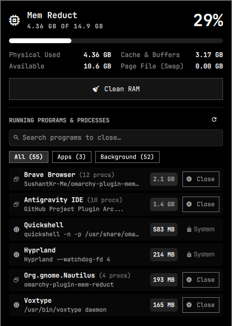

# 🧹 Mem Reduct Plugin (`omarchy-plugin-mem-reduct`)

A powerful, native RAM management and reduction bar widget for [Omarchy](https://omarchy.org)'s Quickshell bar (`omarchy-shell`), inspired by the classic **Mem Reduct** utility with live process termination capabilities.



## Features

- **Bar Pill**:
  - Live RAM percentage (`󰍛 42%`) right in your top bar.
  - Dynamically changes color based on system memory load (normal foreground → warning at 75% → urgent theme color at 90%).
  - Hover tooltip displaying current used memory, total memory, and percentage.
  - Left-click opens the Mem Reduct control center.
  - Right-click immediately launches `btop` in a floating terminal.

- **Mem Reduct Control Center**:
  - **Hero Stats**:
    - Large percentage display and visual progress meter.
    - Real-time used / total memory breakdown.
    - Dynamic status badge showing instant memory freed after cleaning or closing apps.
  - **Detailed Memory Breakdown**:
    - **Physical RAM**: Used, Available, and Total.
    - **Cache & Working Set**: Buffers, Page Cache, and Kernel Slab reclaimable memory.
    - **Page File (Swap)**: Used, Free, and Total swap memory.
  - **Clean RAM (One-Click Optimization)**:
    - Drops pagecache, dentries, and inode caches (`/proc/sys/vm/drop_caches`).
    - Triggers Linux kernel memory compaction (`/proc/sys/vm/compact_memory`).
    - Compacts zram devices (`/sys/block/zram*/compact`) if present.
    - Runs safely via polkit authorization (`pkexec`).
    - Displays exact amount of RAM reclaimed (e.g. `Cleaned 1.2 GB`).

- **Active Programs & Process Closer (Direct RAM Cleaning)**:
  - Lists running programs and high-memory background processes sorted by memory consumption.
  - Displays friendly application names, window titles/commands, and process counts.
  - **Direct "Close" Button**: One-click termination (`SIGTERM` followed by graceful cleanup) to evict memory-hungry applications.
  - **Grouped Process Tree Support**: Closing a browser (e.g. Brave, Chrome) cleanly closes the main window and all worker/renderer processes at once, freeing the entire memory footprint.
  - **Real-Time Search & Filtering**: Type any application name to quickly locate and close it.
  - **Categorized Tabs**: Quick filter by `All`, `Apps` (GUI windows), or `Background` processes.
  - **System Safety Protection**: Critical desktop processes (`Hyprland`, `quickshell`, `systemd`, `pipewire`, `wireplumber`, `dbus`, `polkit`) are marked as `󰌾 System` to prevent accidental desktop crashes.

- **Ollama Integration**:
  - If a local [Ollama](https://ollama.com) instance is running with models loaded into VRAM/RAM, they are listed with an immediate **Unload** button to free inference memory.

## Keyboard Shortcuts

- `Left Click` on bar: Toggle Mem Reduct panel.
- `Right Click` on bar: Open `btop`.
- `Enter` (when search is unfocused): Trigger Clean RAM.
- `Escape`: Close panel.
- `Tab`: Switch to neighboring bar panel.

---

## Installation & Setup

```
omarchy plugin add https://github.com/SushantKr-Me/omarchy-plugin-mem-reduct.git --enable
```

---

## License

MIT License © Sushant Kumar

